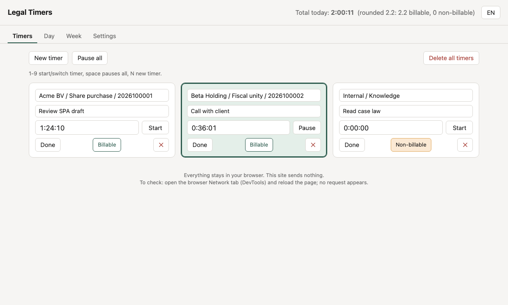
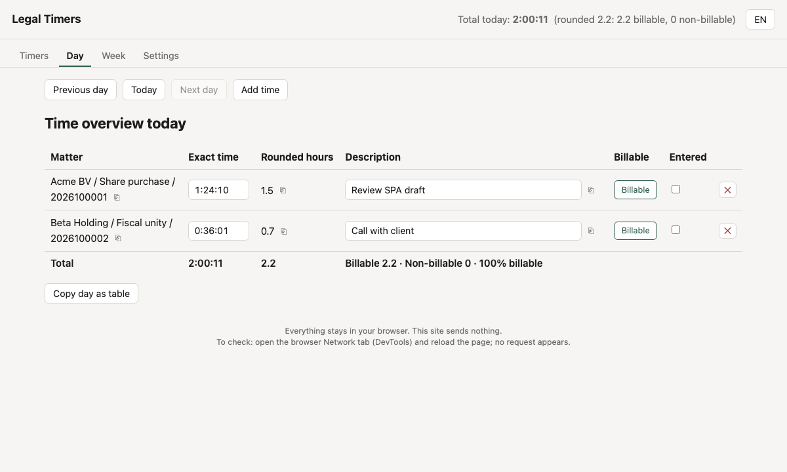

# Legal Timers

[](https://github.com/jorismaas1-web/legaltimers/actions/workflows/test.yml)
[](LICENSE)

A free, unbranded chess-clock timer for lawyers and tax advisers. Start a
timer per matter, switch between them like a chess clock (starting one
pauses the other), and get a rounded day and week overview you can copy
into whatever you bill with.

Try it: **https://legaltimers.com** (Dutch or English, follows your
browser language; switch with the NL/EN button).





## Features

- One card per matter. At most one timer runs; starting another pauses it.
- Type a time straight into a card (`1:30`, `1:30:00`, `1,5`) when you
  forgot to start it.
- Day view: exact time, rounded hours (default 6-minute units, rounded up;
  configurable), description, billable flag and an "entered" checkbox per
  row, with copy buttons per field and "copy day as table" (TSV).
- Week view: hours per matter per day, billable/non-billable totals and an
  optional weekly billable target.
- Manual entries for time without a timer, and earlier days can be filled
  in later.
- Long-run check: a timer that ran over 3 hours or past midnight asks
  whether that is right, and lets you correct the end time.
- Keyboard shortcuts: `1`-`9` start/switch, space pauses all, `N` new timer.
- JSON backup export and import.
- Light and dark mode, NL and EN.

## Privacy

Everything stays in your browser's local storage. The page makes zero
network requests after it loads: no accounts, no analytics, no external
fonts or CDNs, no fetch, no XHR, no WebSocket. This is enforced by a Content
Security Policy (`connect-src 'none'`), not just a promise, so you can check
it yourself: open the browser DevTools Network tab and reload the page.
Nothing should appear after the page's own files. CI also fails if served
code gains a network call.

If you clear your browser data, your times are gone. Make a backup once in
a while (Settings -> Backup). There is no sync between browsers or
computers, on purpose.

## Self-host

There is no build step and no dependency. The served site is the
`public/` folder; put it on any static host. For Cloudflare Pages: no
framework preset, no build command, build output directory `public`. The
`public/_headers` file ships the Content Security Policy and other security
headers there; on other hosts, set the same headers in your server config
(the CSP is also mirrored in a `<meta>` tag in `index.html`, minus
`frame-ancestors`, which only works as a header).

## Run locally

Serve the `public/` folder over HTTP (the page uses ES modules, which
browsers refuse to load from a plain `file://` URL):

```bash
python3 -m http.server -d public   # or: npm start
```

Then open `http://localhost:8000`.

## Test

Requires Node.js 20 or newer. No `npm install` needed.

```bash
node --test   # or: npm test
```

Tests cover the pure logic in `public/src/core.js` (chess-clock rule, elapsed
time, midnight splitting, rounding, parsing, week aggregation, and so on),
the storage load/save and backup validation in `public/src/storage.js`, and
that the NL and EN dictionaries in `public/src/i18n.js` stay in sync.

## Code layout

Everything that is served lives in `public/`:

- `index.html`, `styles.css`: markup and styling.
- `_headers`: CSP and security headers for Cloudflare Pages.
- `favicon.svg`, `og-image.png`, `robots.txt`, `sitemap.xml`: icon, link
  preview image and crawler files for the public site.
- `src/app.js`: DOM and UI wiring.
- `src/core.js`: pure logic, no DOM or storage access, testable in
  isolation.
- `src/storage.js`: localStorage load/save and schema validation.
- `src/i18n.js`: NL/EN string dictionary.

Outside `public/` (not served):

- `test/*.test.js`: tests, run with the Node built-in test runner.
- `docs/SPEC.md`: the full product spec.
- `docs/GUIDE.md`: a short user guide (Dutch).

## Contributing

Bug reports, ideas and pull requests are welcome. Read
[CONTRIBUTING.md](CONTRIBUTING.md) first: the project deliberately stays
small (no framework, no build step, no dependencies, no network), and some
features are out of scope by design. Please never put real client data in
an issue or screenshot.

Security issues: see [SECURITY.md](SECURITY.md).

## License

[MIT](LICENSE)
